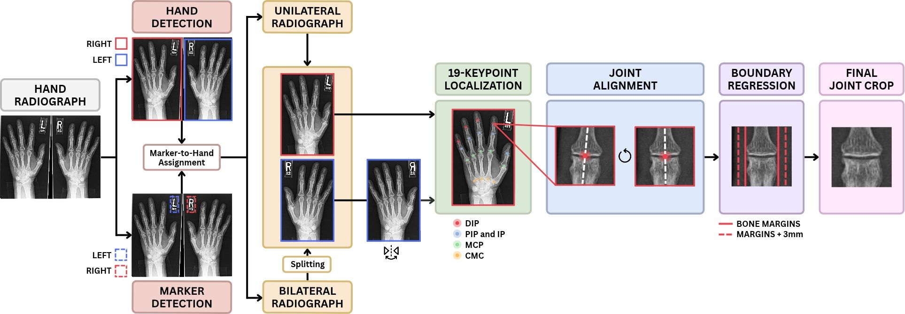
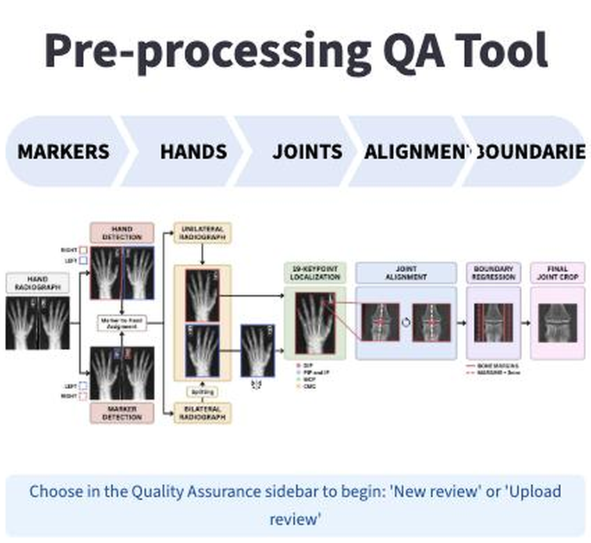
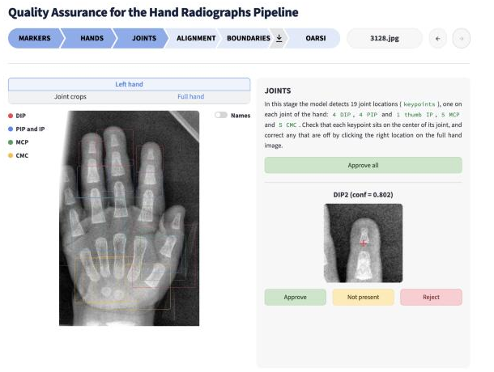

# hand-joint-qa

**From hand radiographs to standardized joint crops, with a local quality assurance interface.**

---

> **Under review.** The interface, code and model weights will be available for
> download in this repository upon acceptance of the paper.

## What it does

A modular pipeline turns a raw hand radiograph into standardized, aligned
224 x 224 crops of the 12 DIP, PIP and MCP joints of digits 2 to 5. It works on
unilateral and bilateral radiographs, with or without laterality markers.

## Models

| Stage | Model | Output |
|---|---|---|
| Markers | YOLOv8n | Left and right marker boxes |
| Hands | YOLOv8n | Hand boxes with thumb side |
| Keypoints | HRNet-W32 | 19 joint centers per hand |
| Alignment | Geometry | Joints rotated along the finger axis |
| Boundaries | Small CNN | Left and right bone margins per joint |

## Interface

A local web application that runs on your own computer. A reviewer checks one
stage at a time and can correct boxes, keypoints, rotation and bone margins.
Each correction updates the later stages.

