

# From Hand Radiographs to Standardized Joint Crops: A Modular and Automated Pipeline with Quality Assurance

> [!NOTE]
> **Under review.** This repository accompanies a paper submitted to ISBI 2027. The interface, code and model weights will be available for download here upon acceptance.

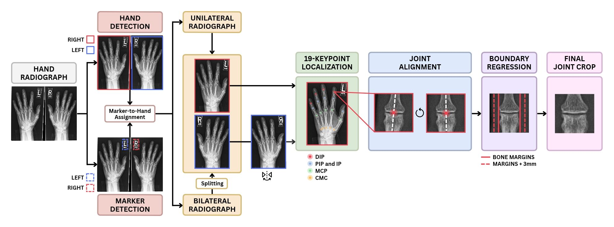

## What it does

A modular pipeline turns a raw hand radiograph into standardized, aligned 224 x 224 crops of the 12 DIP, PIP and MCP joints of digits 2 to 5. It works on unilateral and bilateral radiographs, with or without laterality markers.

## Interface

A local web application that runs on your own computer. A reviewer checks one stage at a time and can correct boxes, keypoints, rotation and bone margins. Each correction updates the later stages.

### 1. Markers

<table>
<tr>
<td width="50%">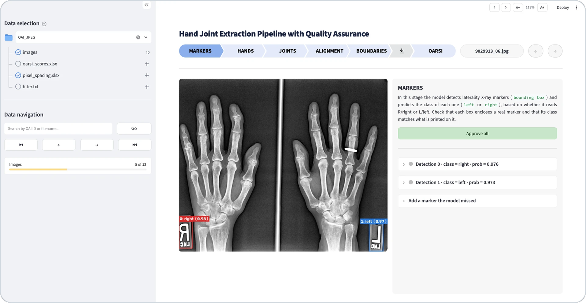</td>
<td width="50%">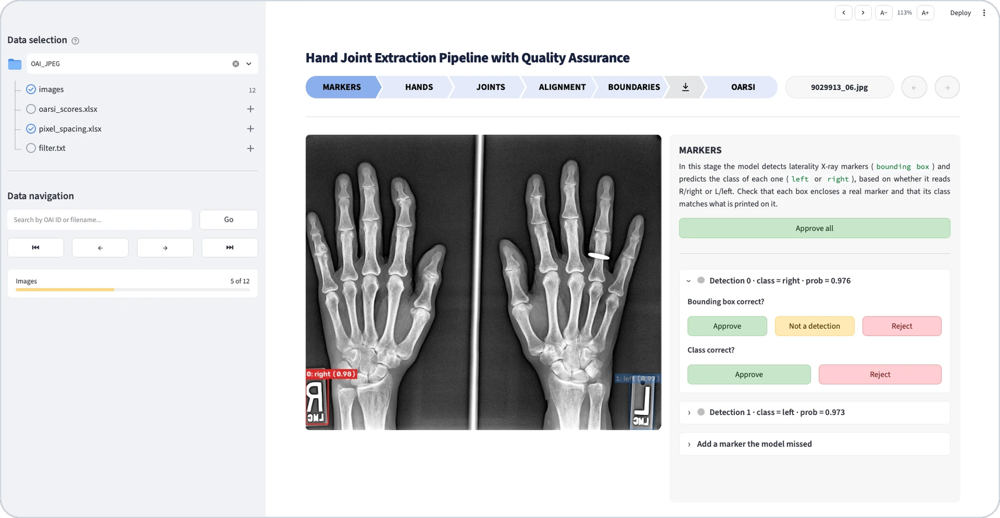</td>
</tr>
</table>

### 2. Hands

<table>
<tr>
<td width="50%">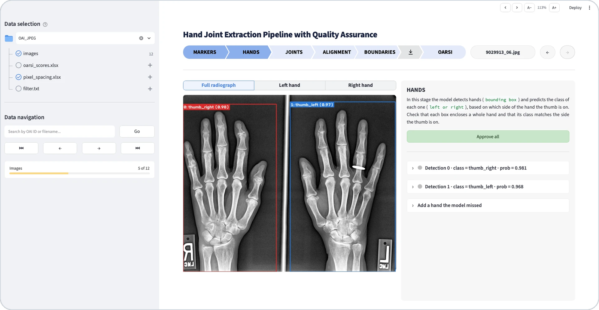</td>
<td width="50%">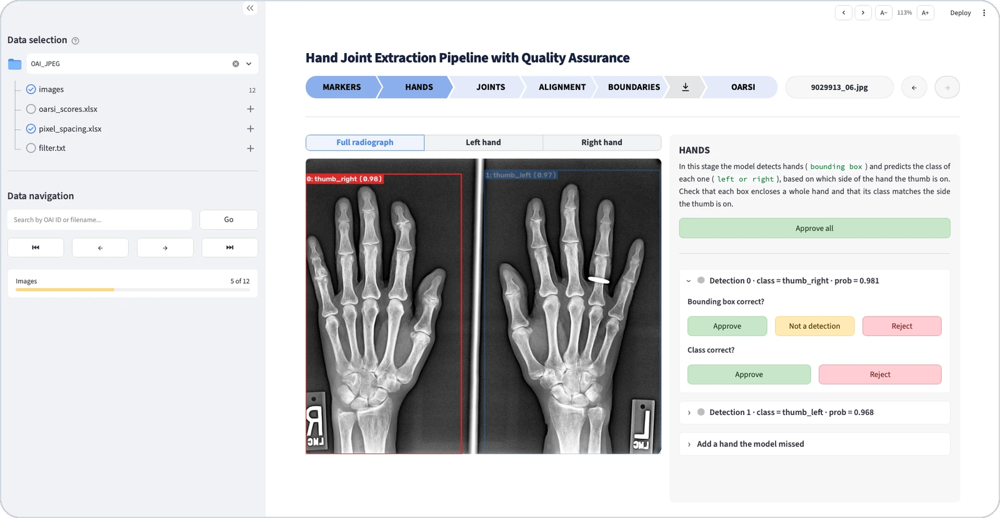</td>
</tr>
</table>

### 3. Joints

<table>
<tr>
<td width="50%">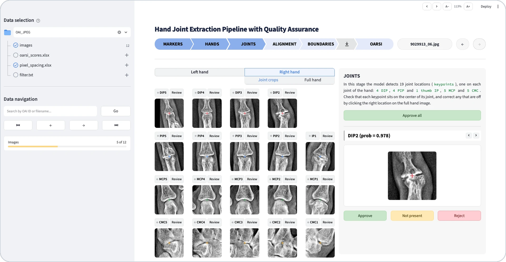</td>
<td width="50%">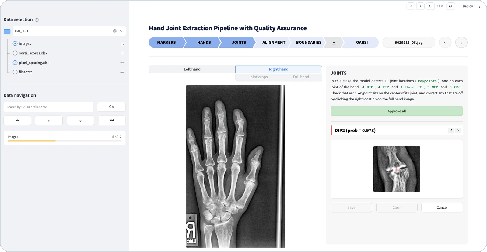</td>
</tr>
</table>

### 4. Alignment

<table>
<tr>
<td width="50%">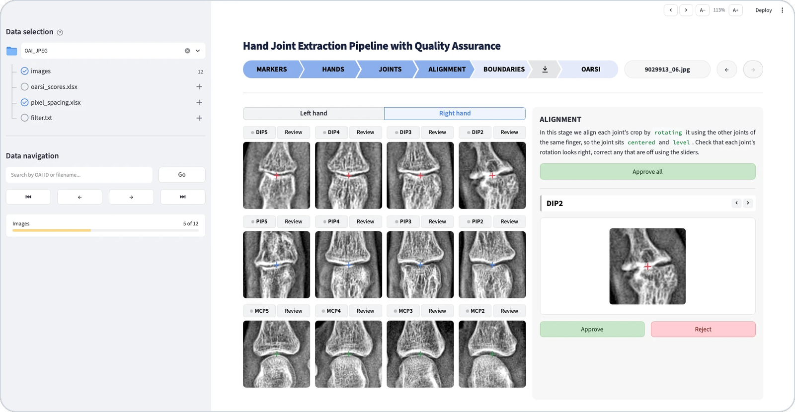</td>
<td width="50%">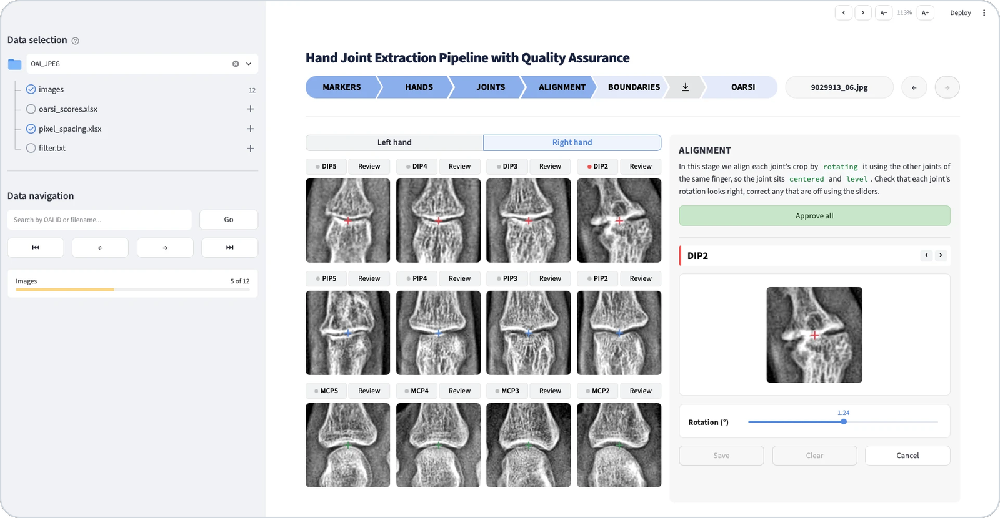</td>
</tr>
</table>

### 5. Boundaries

<table>
<tr>
<td width="50%">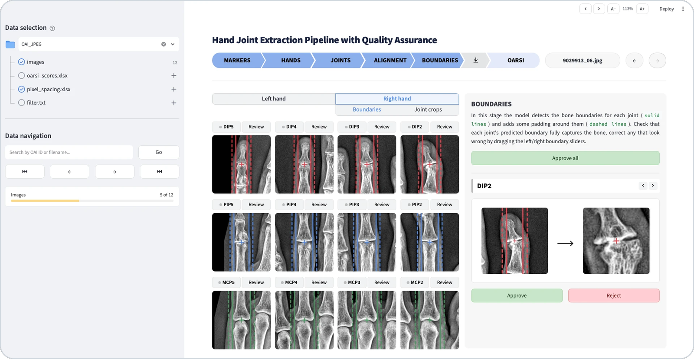</td>
<td width="50%">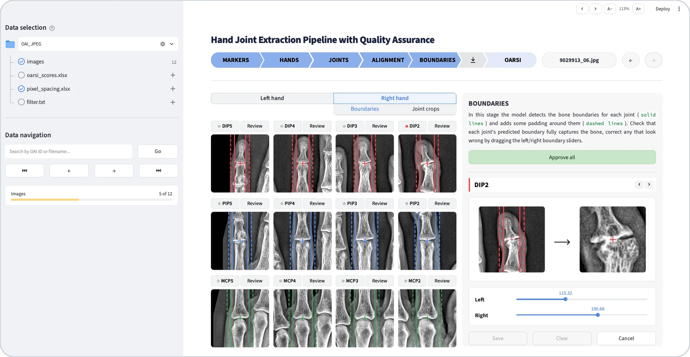</td>
</tr>
</table>

### 6. Download

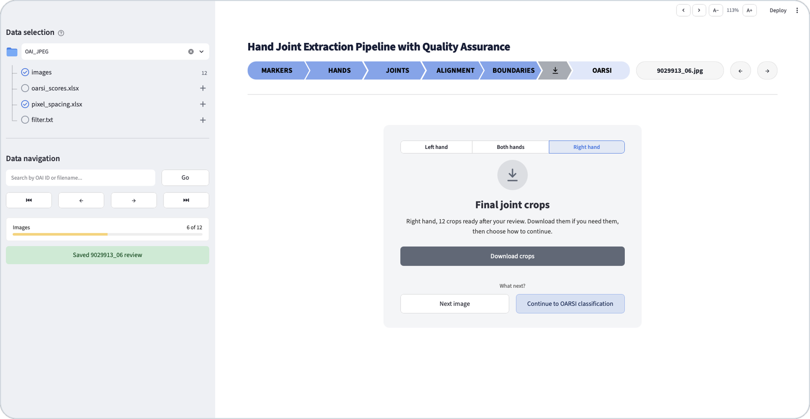

